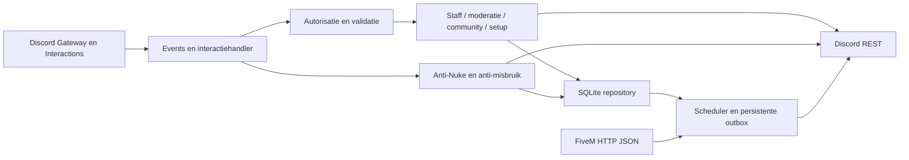

# Architectuur

Node.js 24 LTS, JavaScript ESM, discord.js v14, Discord API v10 en ingebouwde node:sqlite. Eén proces voor één guild. Geen HTTP-beheerinterface, geen AI-provider en geen toegang tot FiveM-console/RCON.

## Vertrouwensgrenzen

Alle slash-, knop-, selectmenu- en modalhandlers controleren guild, actor en rechten server-side. Configuratie is toegankelijk voor expliciet ingestelde ownerrollen, of voor expliciete ownergebruikers die ook guildeigenaar/Administrator zijn. Op verzoek van de gebruiker is rol `1226509285924540473` de configuratieroot in het servervoorbeeld. Deze root staat in `.env` en is niet via het paneel te wijzigen. Die rol geeft niet automatisch toegang tot gewone staff- of moderatiecommands: daar blijven een geconfigureerde staffrol én de vereiste Discord-permissie nodig; de guildowner behoudt gewone commandtoegang. Beveiligingsallowlists geven geen commandrechten. Owneraccounts zijn beschermd tegen staff- en moderatiemutaties. De bot geeft geen Administrator-permissie aan een rol en verwijdert alleen gevaarlijke rollen onder zijn eigen hoogste rol. Bestaande geconfigureerde rankrollen kunnen hun eigen rechten hebben; toewijzing vereist een hogere actor- en botrol en voldoende actorpermissies. Ownerrollen worden niet via staffcommands toegekend.

## Opslag en herstel

Versioned SQL-migraties, foreign keys, WAL, busy timeout, prepared statements en korte synchrone transacties. Tabellen voor configuratie, actieregister, staff, sancties, securityhits, auditlogs, outbox, giveaways, deelnemers, trekkingbewijzen, documenten, acceptaties, evenementen, aanmeldingen, kanaalsloten en setupsessies. SQLite-details blijven in de repositorylaag; PostgreSQL vereist een aparte asynchrone adapter en migraties, geen simpele connection-stringwissel.

Een Discord-mutatieresultaat en een SQL-commit kunnen niet atomair gebeuren. Het actieregister wordt vóór de mutatie geschreven. Open mutaties worden bij opstart `uncertain`, gelogd en via `/systeem acties` zichtbaar gemaakt. Ze worden niet blind opnieuw uitgevoerd. Tijdelijke bans worden vooraf ingepland en na een crash tegen Discord gecontroleerd. Permanente bans hebben geen vervaltijd. Een generatie-token in de auditreden voorkomt dat een latere andere ban onterecht wordt opgeheven. Outboxberichten bevatten een unieke referentie en worden bij retry gezocht in de laatste 100 berichten; volledige exactly-once-garantie biedt Discord niet.

De scheduler gebruikt SQL-status en geen losse setTimeout als bron van waarheid. Een enkele worker verwerkt vervallen taken, herstelbare trekkingen, reminders en outboxretries. Giveawayselectie: vooraf gepubliceerde SHA-256 commitment van een cryptografisch seed; deelnemers worden bij afsluiten opnieuw gevalideerd; gesorteerde snapshot plus seed bepalen de winnaars reproduceerbaar. Te weinig geldige deelnemers betekent geen winnaars. Een herstart wist geen aanmeldingen. Een reroll krijgt een nieuwe persistente commitment, een korte wachttijd en een nieuw bewijs; vorige winnaars worden uitgesloten.

## Beveiliging

Auditlog-entry-ID's worden gededupliceerd in SQLite. Sliding windows voor gevoelige acties blijven bij herstart bestaan. Serverevents leveren onafhankelijke waarnemingen; als attributie ontbreekt, volgt een melding zonder accountbestraffing. Geconfigureerde vertrouwde accounts worden wel gelogd, maar niet automatisch zwaar gesanctioneerd. Een overschrijding beperkt alleen een aantoonbare actor. Ontbrekende auditrechten, rolhiërarchie of REST-fouten worden zichtbaar gelogd. Geen claim van volledige rollback: verwijderde berichten/kanalen worden niet gereconstrueerd. Een beveiligingsactie kan pas plaatsvinden nadat Discord het event heeft geleverd.

## Extra modules

FiveM-status via `dynamic.json`, `info.json`, `players.json`, met timeouts, omvanglimiet, vaste URL uit `.env`, cache en expliciete onbereikbaarstatus. Geen IP's, licenses of identifiers publiceren. Spelersnamen alleen na expliciete configuratie. APV/regels: eigen inhoud, onveranderlijke versies, publiceren en versiegebonden accepteren. Evenementen: Discord Scheduled Events voor externe evenementen plus persistente RSVP, capaciteit en reminders. Interne staffwaarschuwingen: privé-output en een gecontroleerd intern logkanaal. Setup: eigenaargebonden sessies met verloop, versiecontrole tegen gelijktijdige wijzigingen, kanaal-/rolselecties en gevalideerde modals.

## Verificatie

Offline tests gebruiken echte SQLite en gesimuleerde Discord-grenzen. Ze testen beleidsbeslissingen, herstel, tijdelijke bans, trekking, capaciteit, configuratievalidatie en auditdeduplicatie. `npm run check` parseert alle JS-bestanden, importeert modules en valideert de complete slash-commandregistratie. `npm run doctor` controleert met echte credentials guild, rolpositie en kanalen. Een live acceptatietest in een afgeschermde testguild blijft noodzakelijk vóór productie.
