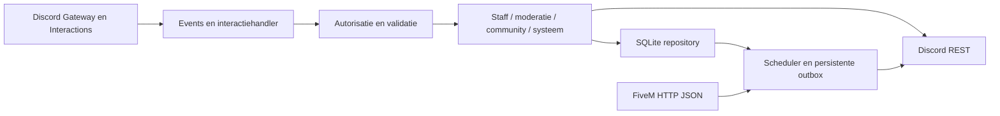

# Architectuur

Node.js 24 LTS, JavaScript ESM, discord.js v14, Discord API v10 en ingebouwde node:sqlite. Eén proces voor één guild. Geen HTTP-beheerinterface, geen AI-provider en geen toegang tot FiveM-console/RCON.

## Vertrouwensgrenzen

Alle slash- en knophandlers controleren guild, actor en rechten server-side. Rol `1226509285924540473` is standaard de Beheerrol en geeft toegang tot alle commands. Administrator en de servereigenaar hebben eveneens alle commandrechten. `MANAGEMENT_ROLE_IDS` kan andere Beheerrollen aanwijzen; bestaande `BOT_OWNER_ROLE_IDS` blijven ondersteund. Gewone moderatie is daarnaast toegankelijk via de bijbehorende Discord-permissie, zonder vooraf ingestelde staffgroepen. Staff-, communicatie-, communitybeheer- en systeemcommands vereisen Beheer, Administrator of de servereigenaar. Deze toegang vervangt de menselijke Discord-commandpermissie; botrechten, hiërarchie en beschermde accounts worden bij daadwerkelijke mutaties gecontroleerd.

Staffcommands gebruiken native Discord-rolopties: `functie` voor aannemen en `nieuwe_rank` voor staffupdate. De geselecteerde `role_id` wordt bij de medewerker opgeslagen. Ranknamen kunnen optioneel uit de configuratie komen; bestaande numerieke levels blijven ondersteund als configuratiegegevens. Rankrichting gebruikt altijd de Discord-rolvergelijking. Actor- en botrolpositie, managed rollen en beschermde Beheerrollen worden vóór de mutatie gecontroleerd. Beheerrollen worden niet via staffcommands toegekend.

Staffupdate geeft de nieuwe rol en verwijdert de oude opgeslagen/herkende staffrankrollen. Ontslag verwijdert altijd de opgeslagen/herkende staffrollen en behoudt andere communityrollen. Oude en nieuwe rol-ID's worden naast ranknamen in de historie bewaard.

RLRP heeft vaste publicatiebestemmingen: aannemen, ontslag en staffupdate in `1560050091245699245`, changelog in `1226509287459655704`, APV in `1226509286587498599` en regels in `1226509286587498597`. De configuratielaag past deze waarden ook op bestaande databases toe. Configuratie-import kan deze bestemmingen niet vervangen. Changelog vraagt alleen `naam` en `inhoud`; `versie` is optioneel. Staffembeds tonen geen foto's. De outbox gebruikt een Discord-nonce als retryreferentie, niet een zichtbare UUID in de footer.

## Opslag en herstel

Versioned SQL-migraties, foreign keys, WAL, busy timeout, prepared statements en korte synchrone transacties. Tabellen voor configuratie, actieregister, staff, sancties, auditlogs, outbox, giveaways, deelnemers, trekkingbewijzen, documenten, acceptaties, evenementen, aanmeldingen, kanaalsloten en paginaviews. SQLite-details blijven in de repositorylaag; PostgreSQL vereist een aparte asynchrone adapter en migraties, geen simpele connection-stringwissel.

Een Discord-mutatieresultaat en een SQL-commit kunnen niet atomair gebeuren. Het actieregister wordt vóór de mutatie geschreven. Open mutaties worden bij opstart `uncertain`, gelogd en via `/systeem acties` zichtbaar gemaakt. Ze worden niet blind opnieuw uitgevoerd. Tijdelijke bans worden vooraf ingepland en na een crash tegen Discord gecontroleerd. Permanente bans hebben geen vervaltijd. Een generatie-token in de auditreden voorkomt dat een latere andere ban onterecht wordt opgeheven. Outboxberichten bevatten een unieke referentie en worden bij retry gezocht in de laatste 100 berichten; volledige exactly-once-garantie biedt Discord niet.

De scheduler gebruikt SQL-status en geen losse setTimeout als bron van waarheid. Een enkele worker verwerkt vervallen taken, herstelbare trekkingen, reminders en outboxretries. Giveawayselectie: vooraf gepubliceerde SHA-256 commitment van een cryptografisch seed; deelnemers worden bij afsluiten opnieuw gevalideerd; gesorteerde snapshot plus seed bepalen de winnaars reproduceerbaar. Te weinig geldige deelnemers betekent geen winnaars. Een herstart wist geen aanmeldingen. Een reroll krijgt een nieuwe persistente commitment, een korte wachttijd en een nieuw bewijs; vorige winnaars worden uitgesloten.

## Commandregistratie, hulp en moderatie

De hosting-entry laadt een lokale `.env` alleen als die bestaat; ingestelde hostingvariabelen hebben voorrang. Automatische guildregistratie staat standaard aan en wordt gestuurd met `REGISTER_COMMANDS_ON_START`. Registratie gebruikt dezelfde registry als de handlers en `/help`. De helpweergave genereert alle commands, subcommands, parameters en vereiste toegang uit die definities. Daardoor blijven registratie, commandrouting en hulp gelijklopen.

Gewone moderatie loopt via slash commands en daadwerkelijke Discord REST-acties. Hiërarchie, beschermde accounts, invoervalidatie, mentions en command-rate-limits worden centraal gecontroleerd. Auditlogevents leveren wijzigingslogs. Tijdelijke sancties worden door de scheduler afgehandeld en fouten worden gelogd.

## Extra modules

FiveM-status via `dynamic.json`, `info.json`, `players.json`, met timeouts, omvanglimiet, vaste URL uit de environmentvariabelen, cache en expliciete onbereikbaarstatus. Geen IP's, licenses of identifiers publiceren. Spelersnamen alleen na expliciete configuratie. APV/regels: eigen inhoud, onveranderlijke versies, publiceren en versiegebonden accepteren. Evenementen: Discord Scheduled Events voor externe evenementen plus persistente RSVP, capaciteit en reminders. Interne staffwaarschuwingen: privé-output en een gecontroleerd intern logkanaal. Optionele geavanceerde instellingen gaan via het configuratiebestand en gevalideerde CLI-import. Ontbrekende logkanalen verhinderen database-logging niet.

## Verificatie

Offline tests gebruiken echte SQLite en gesimuleerde Discord-grenzen. Ze testen autorisatie, rolselectie, vaste publicatiekanalen, herstel, tijdelijke bans, trekking, capaciteit, configuratievalidatie, commandhulp en hostingopstart zonder `.env`. `npm run check` parseert alle JS-bestanden, importeert modules en valideert de complete slash-commandregistratie. `npm run doctor` controleert met echte credentials de guild, kernbotrechten en vaste publicatiekanalen en toont de hoogste botrol. Rolhiërarchie voor een gekozen staffrank wordt bij het command gecontroleerd. Een live acceptatietest in een afgeschermde testguild of gecontroleerd testkanaal blijft noodzakelijk vóór productie.
